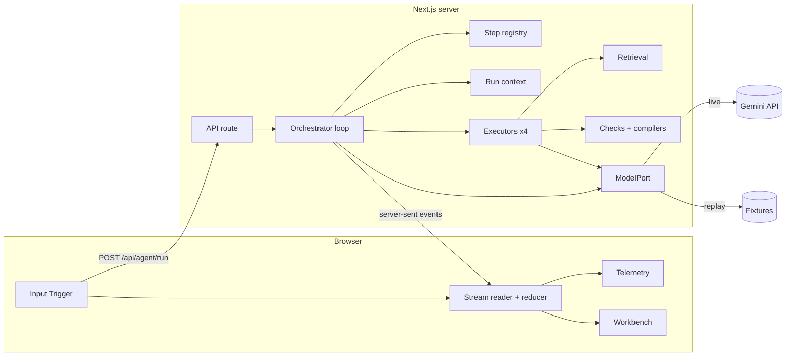

# GroundTruth

GroundTruth is an Answer Engine Optimization (AEO) defect-remediation agent. It reproduces the wrong answer an AI search engine gives a buyer about your docs, traces that answer to the sentence that caused it, and writes a patch that fixes the page.

You press one button. Gemini makes four tool calls in a fixed order, and the run ends in a merge-ready bundle: a defect ticket, a unified `git` diff, and JSON-LD for the page `<head>`. There is no chat box.

For an interactive map of the system, open [`docs/architecture.html`](docs/architecture.html) in a browser. Press Play to step through one audit, or click a component to see what it does and why it exists.

## The problem

B2B SaaS buyers now ask AI search engines questions such as "Does CloudPulse's Pro plan support HIPAA compliance and SSO?" instead of reading the docs. These engines don't read the whole page. They retrieve a few passages that match the question's words and answer confidently from those passages.

When a docs page puts a vague marketing claim at the top and buries the real condition in a footnote or a distant FAQ, the engine retrieves the claim and misses the condition. The buyer gets a false answer. The result is lost deals, compliance and legal exposure, and sales engineers spending time correcting buyers.

Existing AEO tools report a visibility score. GroundTruth reports the cause and delivers the fix as a patch.

### The default demo: CloudPulse

| Step | What happens |
|---|---|
| Buyer asks | "Does CloudPulse's Pro plan support HIPAA compliance and SSO?" |
| Engine retrieves | The banner "Enterprise-grade SOC2 & HIPAA security across our platform" and the plans table |
| Engine misses | The FAQ line "BAAs are available on the Enterprise plan only". It never uses the word "HIPAA", so the search skips it. |
| Engine answers | Pro runs on HIPAA-grade security. This is false, because a HIPAA BAA needs the $499/mo Enterprise plan. |
| GroundTruth outputs | A ticket naming the banner as the root cause, and a patch that adds `## Which plans include HIPAA BAA and SSO?` with the answer in the first sentence |

## How it works

An audit runs four steps. Each step has a Gemini function name and a UI label.

| # | Gemini function | UI label | What it does |
|---|---|---|---|
| 1 | `parse_doc_claims` | `extract_ground_truth()` | Lists every claim on the page that bears on a ground-truth rule, and tags each claim as `explicit`, `buried`, `contradicted`, or `missing`. |
| 2 | `test_buyer_prompt` | `simulate_buyer_synthesis()` | Retrieves the 3 passages that best match the buyer question. The model answers from only those passages, and it never sees the ground truth. |
| 3 | `verify_causal_harm` | `diagnose_causal_defect()` | Compares the answer with the rules. Returns the defect type (`False Claim`, `Omitted Condition`, or `Broken Route`), the harm level (`Critical`, `High`, `Medium`, or `Low`), the false sentence, a verbatim quote of the page passage that caused it, and an acceptance test. |
| 4 | `generate_pr_artifact` | `compile_remediation_patch()` | Rewrites the page answer-first. Code builds the unified diff and the JSON-LD. |

If step 3 finds no defect, step 4 is skipped and the run ends with the outcome `no_defect`.

### The UI

| Panel | Contents |
|---|---|
| Input Trigger (left) | A picker for the three scenarios, plus editable fields for the doc, the buyer question, and the ground-truth rules (one rule per line). It has one button, **Execute Causal AEO Audit**. |
| Live Agent Telemetry (center) | One node per step. Each node shows the arguments the model chose, a live timer while the step runs, the elapsed milliseconds, and the output JSON. |
| Artifact Workbench (right) | Four tabs. The **Defect Ticket** tab shows the question, the wrong answer, the retrieved passages, the false statement, the violated rule, the root-cause excerpt, the explanation, and the acceptance test. **Diff** shows a side-by-side view. **JSON-LD** shows the schema. **Export** downloads the `.patch` file and copies the `git apply` command, the PR title and body, and the `<script type="application/ld+json">` tag. |

A badge in the header always shows the mode: `LIVE · <model>`, or `REPLAY · no API key (hand-authored sample)`.

## Architecture



When you click the button, the flow is as follows:

1. The browser posts the scenario to `POST /api/agent/run`.
2. The route validates the body, chooses a model port (live or replay), opens a `text/event-stream` response, and calls `runAgent`.
3. For each step, the loop asks Gemini for a function call. The request allows only that step's function (`mode: ANY`, `allowedFunctionNames: [step]`). The loop checks the returned name, emits `step_start`, runs the executor, emits `step_done`, and sends a short summary back to Gemini as the `functionResponse`.
4. Each executor reads the real data from the run context. It makes an inner Gemini call with a JSON response schema, validates the result, and returns a typed output.
5. The browser reads the stream with `fetch`. A reducer turns each event into a per-step state (`pending`, then `running`, then `done`, `error`, or `skipped`). Every panel renders from that state.

Event types are `run_start`, `step_start`, `step_done`, `step_error`, `step_skipped`, `run_done`, and `run_error`.

### Components

| Component | File | Responsibility |
|---|---|---|
| Data contract | `src/lib/domain.ts` | The shared types: `Scenario`, step IDs, per-step outputs, `DefectRecord`, and the `AgentEvent` union |
| Step registry | `src/lib/steps.ts` | One ordered list of the steps: Gemini name, UI label, summary, and function declaration |
| Orchestrator loop | `src/lib/agent.ts` (`runAgent`) | Runs the four forced turns, checks the call name, emits events, and skips step 4 when no defect is found |
| Executors | `src/lib/agent.ts` (`EXECUTORS`) | The prompt, inner model call, and validation for each step |
| Checks and compilers | `src/lib/agent.ts` | The verbatim-quote check and the new-heading check (one retry each), the trailing-newline fix, the jsdiff patch, and the JSON-LD builder |
| Retrieval | `src/lib/retrieval.ts` | Splits the page into passages and keeps the top 3, scored by question-word overlap weighted by rarity |
| Model port | `src/lib/model.ts` | The `ModelPort` interface with its live (Gemini SDK) and replay (fixtures) versions, the JSON output schemas, and the retry on 429 |
| API route | `src/app/api/agent/run/route.ts` | Validates the request body and streams events |
| Client state | `src/lib/run-state.ts` | The reducer from `AgentEvent` to run state |
| UI | `src/components/Console.tsx`, `Telemetry.tsx`, `Workbench.tsx` | The three panels |
| Fixtures | `src/fixtures/scenarios.ts` | The three demo scenarios and their replay data |
| Self-check | `scripts/check.mjs` | An end-to-end check against a running server |

## Design decisions

| Decision | Reason |
|---|---|
| Real function calling, forced one step per turn | The tool calls are genuine and their arguments are visible, but the order can't drift. The brief requires one trigger, four tool calls, and one PR artifact. |
| The server owns the data, and model arguments are only labels | A model that copies 3 KB of markdown through tool arguments sometimes changes it. Executors read the authoritative text from the run context. |
| The buyer simulation never sees the ground truth | If the rules reached the simulated engine, it would answer correctly and there would be no defect to find. |
| The simulation answers from 3 retrieved passages | Real answer engines answer from retrieved passages. When the model read the whole page, it found the buried FAQ, and two of the three demos returned "no defect". |
| Code builds the diff and the JSON-LD | Diffs written by a model often fail to apply, and JSON written by a model can be invalid. Built in code, the patch always applies and the JSON always parses. |
| Validation with one retry | The root-cause quote must appear verbatim in the doc, and the rewrite must add a new H2 or H3. Each failure gets one retry with feedback, then the step errors. |
| One step registry and one reducer | The Gemini declarations and the UI nodes can't fall out of sync, and no two panels can disagree about a step's state. |
| Live and replay behind one `ModelPort` | Replay works without a key or network, and it still computes the diff and the JSON-LD for real. The badge prevents replay from passing for live output. |
| Export instead of a real GitHub PR | Opening a PR needs a GitHub token and writes to a repository. |
| Fixtures instead of scraping | Scraping is not the point of the demo, and venue networks are unreliable. |

## Demo scenarios

| Scenario | Buyer question | Buried condition | Expected defect |
|---|---|---|---|
| CloudPulse | Does CloudPulse's Pro plan support HIPAA compliance and SSO? | The HIPAA BAA and SAML SSO are Enterprise-only. This is stated in a FAQ that never says "HIPAA". | False Claim, Critical |
| Relaywave | Is there any limit on API calls on Relaywave's Growth plan? | Growth is capped at 1,000,000 requests a month. This is stated in a footnote that says "requests", not "API calls". | Omitted Condition |
| Ledgerline | Where do I set up SAML SSO in Ledgerline, and which plan do I need? | The documented setup page was removed in console v4. | Broken Route |

## Setup

Requires Node.js 22.18 or later, so that the check script can import TypeScript fixtures. The project was tested on Node 26.

```bash
npm install
cp .env.local.example .env.local
```

To use live mode, set `GEMINI_API_KEY` in `.env.local`. Get a key from Google AI Studio.

| Variable | Required | Default | Purpose |
|---|---|---|---|
| `GEMINI_API_KEY` (or `GOOGLE_API_KEY`) | No | none | Turns on live mode. Without a key, the app runs in replay mode. |
| `GEMINI_MODEL` | No | `gemini-3.5-flash-lite` | Sets the Gemini model ID |

## Run

```bash
npm run dev
```

Open http://localhost:3000, choose a scenario, and press **Execute Causal AEO Audit**.

In replay mode, the app plays back hand-written outputs for the three fixtures. If you edit the doc, the question, or the rules, replay mode refuses the run, because no recorded output exists for that input.

## Verify

Run the check against a running server:

```bash
npm run check -- http://localhost:3000
```

The check posts each fixture and asserts the following:

- The four steps run in registry order, and every step reports a numeric duration.
- Each demo produces a defect of the expected type.
- The buried condition is on the page but is not among the retrieved passages.
- The root-cause excerpt appears verbatim in the doc.
- The patch applies cleanly to the original doc and reproduces the rewrite exactly.
- Every JSON-LD object parses, with `@context` set to schema.org and `@type` set to `FAQPage` or `Product`.
- The rewrite adds an H2 or H3 whose next line names the required tier.
- A malformed request returns 400.
- An edited scenario in replay mode returns `run_error`.

Also run `npm run build` and `npm run lint`.

## Status

The following was verified on 2026-11-07:

- `npm run check` passes in live mode (`gemini-3.5-flash-lite`) and in replay mode.
- Typecheck and lint pass.
- A live CloudPulse run in the browser finished in about 19 seconds and rendered the ticket, the retrieved passages, the diff, and the JSON-LD.
- The page has no horizontal scroll at 375 px width.
- A generated patch applied with `git apply` produces the expected rewrite byte for byte.

## Known limitations

- **Rate limits.** One audit makes 8 Gemini requests: 4 orchestrator turns and 4 inner calls. The free tier allows 15 requests a minute, so back-to-back audits slow down while the SDK retries rate-limited requests (`attempts: 5`, `initialDelay: 4`, `maxDelay: 40`).
- **Model availability.** `gemini-2.5-flash` and `gemini-2.5-pro` are refused for new API keys, even though they still appear in the model list.
- **Label variance.** In live mode, the defect label can change between runs. CloudPulse has returned both `False Claim` and `Omitted Condition`, both rated Critical. The check expects the exact label, so a live run can fail on the label alone.
- **Retrieval.** Retrieval is a keyword stand-in. Real engines use embeddings and reranking, so the simulation reproduces their failure mode, not any specific engine.
- **Untested paths.** No fixture produces the `no_defect` path, so that path has only been reviewed in code. The Download and Copy buttons have not been clicked in testing. A failed clipboard write is not handled.
- **Cancellation.** Closing the browser tab does not cancel a live run, so its Gemini calls still complete.
- **JSON-LD offers.** `Product` offers are parsed from Markdown price tables only.

## Project layout

```text
groundtruth/
├── docs/architecture.html      # interactive architecture map
├── scripts/check.mjs           # end-to-end self-check
└── src/
    ├── app/
    │   ├── api/agent/run/route.ts
    │   ├── layout.tsx
    │   └── page.tsx
    ├── components/             # Console, Telemetry, Workbench
    ├── fixtures/scenarios.ts   # the 3 demos and their replay data
    └── lib/
        ├── domain.ts           # data contract
        ├── steps.ts            # step registry
        ├── agent.ts            # loop, executors, checks, compilers
        ├── model.ts            # live and replay model ports
        ├── retrieval.ts        # top-3 passage retrieval
        └── run-state.ts        # client reducer
```

## Stack

Next.js 16 (App Router), React 19, Tailwind CSS 4, TypeScript, `@google/genai` 3, `diff` (jsdiff) 9, and `lucide-react`.
